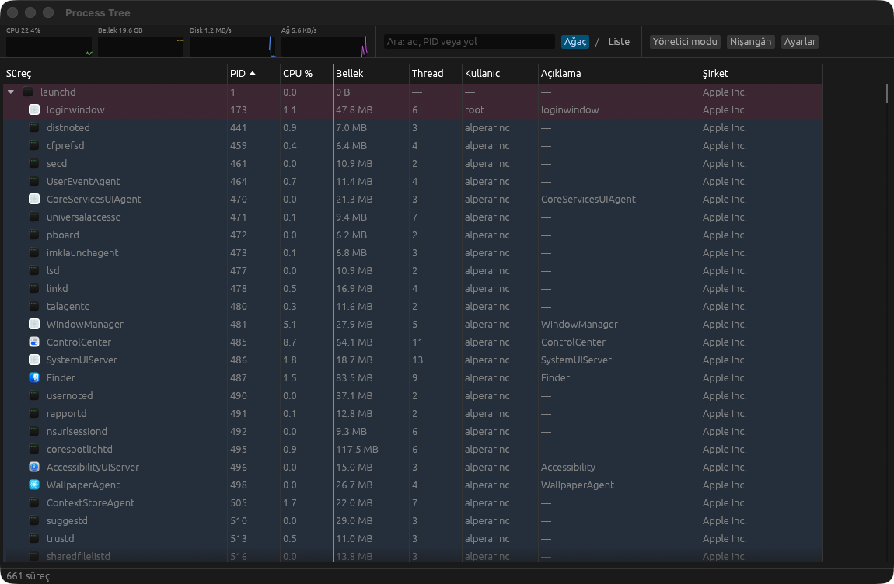

# Process Tree for macOS

**A fast, native process explorer for macOS — written in Rust.**
See every process as a tree, with what it has open, what it's connected to, who signed it, and whether VirusTotal knows it.



> Türkçe özet aşağıda / Turkish summary below.

## Why

Activity Monitor tells you *that* something is busy. Process Tree tells you *what it is and what it's doing*: its parent chain, open files and sockets, loaded libraries, threads, network connections, code signature and environment — all in one window, using about 1 % of one CPU core.

## Features

- **Process tree** — parent → child hierarchy with fold/unfold, or a flat sortable list. Columns: name + icon, PID, CPU %, memory, threads, user, description, company, VirusTotal. Click to sort, right-click a header to show/hide columns.
- **Live colour coding** — your processes, system/root processes, newly started (green), just exited (red), suspended (grey).
- **Search** by name, PID or path; matches keep their parents so the tree stays readable.
- **Detail tabs** for the selected process: open files & sockets, loaded libraries, threads (with per-thread CPU), TCP/UDP connections.
- **Properties window** — full path, command line, environment variables, working directory, start time, parent, code signature (valid?, signer, Team ID, company) and CPU / memory history graphs.
- **System graphs** — CPU, memory, disk and network at a glance.
- **Actions** — terminate, force kill, kill process tree, suspend / resume, change priority (nice), reveal in Finder. Destructive actions always ask first and are protected against PID reuse.
- **Crosshair** — drag it onto any window to jump to the process that owns it.
- **Admin mode** — one click, macOS password prompt, and you can inspect system and other users' processes too (see *Security* below).
- **VirusTotal (opt-in)** — with your own API key, every running executable is checked automatically in the background. Only the SHA-256 hash is ever sent, never the file. Results are cached across restarts and the free-tier rate limits are respected.
- **Light on resources** — about 1 % of one CPU core while idle, slower sampling when the window is in the background.

## Install

1. Download `Process-Tree-<version>-macos-arm64.zip` from [Releases](../../releases/latest) and unzip it.
2. Move **Process Tree.app** to your Applications folder.
3. The app is not notarized by Apple (it's a free hobby project), so the first time run:

   ```sh
   xattr -dr com.apple.quarantine "/Applications/Process Tree.app"
   ```

   or right-click the app → **Open** → **Open**.

**Requirements:** macOS 13 or newer, Apple Silicon (M1 and later).

## Build from source

```sh
git clone https://github.com/alperarinc/process-tree.git
cd process-tree/procexp
cargo test
./bundle.sh        # builds a release .app and installs it to ~/Applications
```

Needs Rust 1.92+ and Xcode Command Line Tools.

## Security & privacy

- **Admin mode** never runs the window as root. It starts a short-lived helper (the same binary with `--helper`) through the standard macOS password prompt. The helper talks to the app over a private Unix socket protected by directory permissions, a random token and peer-UID checks, installs nothing, and exits when the app closes. Caveat: as with any tool that elevates its own binary, malware already running as your user could tamper with the app before you elevate it.
- **VirusTotal** is off by default. When you turn it on, only SHA-256 hashes go to `virustotal.com`, using your own API key. The key lives in `~/Library/Application Support/ProcessTree/settings.json` (mode 0600).
- No telemetry, no other network traffic.

## Known limitations

- Most system libraries live in the dyld shared cache, so the *Libraries* tab shows the cache file rather than each framework.
- Per-process GPU usage isn't available (macOS has no reliable public source for it).
- Some SIP-protected processes stay unreadable even in admin mode.
- The UI is currently in Turkish.

## License

[MIT](LICENSE) © Alper ARİNÇ

Not affiliated with or endorsed by Microsoft. "Process Explorer" is a trademark of Microsoft; this is an independent macOS tool inspired by it.

---

## Türkçe

**Process Tree**, macOS için Rust ile yazılmış, Windows Process Explorer'dan esinlenen ücretsiz bir süreç gezgini. Tüm süreçleri ağaç halinde, açık dosyaları, soketleri, kütüphaneleri, thread'leri, ağ bağlantıları, imza bilgisi ve isteğe bağlı VirusTotal sonuçlarıyla gösterir. Boştayken tek çekirdeğin yaklaşık %1'ini kullanır.

**Kurulum:** [Releases](../../releases/latest) sayfasından zip'i indir, `Process Tree.app`'i Uygulamalar klasörüne taşı, ilk açılıştan önce şunu çalıştır:

```sh
xattr -dr com.apple.quarantine "/Applications/Process Tree.app"
```

Gereksinimler: macOS 13+, Apple Silicon.
